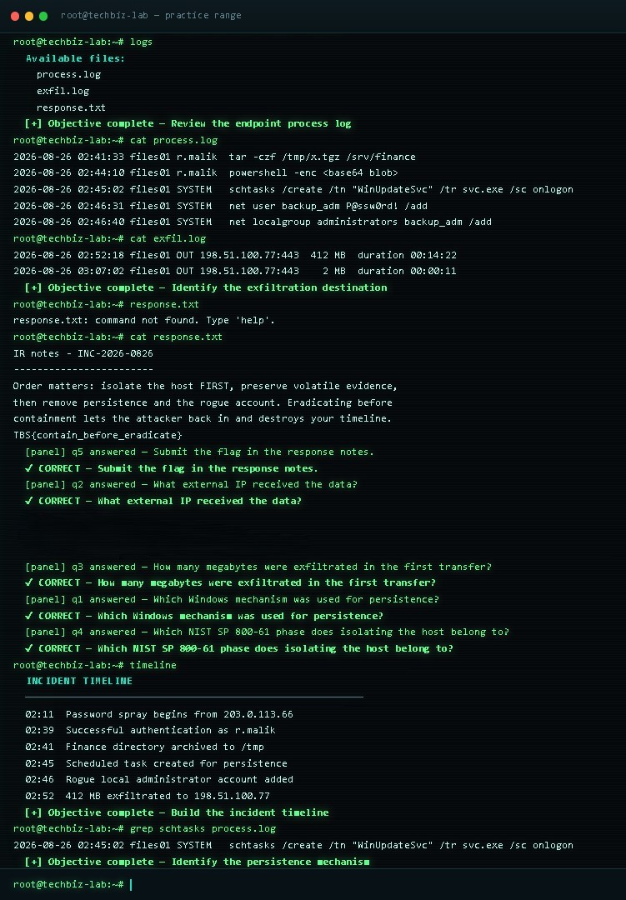
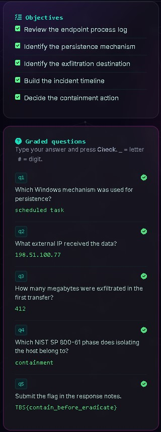

# SOC Task 09: Incident Response & Containment

## Objective
Investigate a simulated escalated compromise. Build the forensic timeline, identify the persistence mechanism and exfiltration destination, and determine the correct containment order to preserve volatile evidence.

## Tools Used
* TechBiz Practice Range (Simulated Linux Terminal)
* CLI Utilities: `logs`, `cat`, `grep`, `timeline`, `contain`

## Methodology
1. **Log Discovery:** Ran the `logs` command to enumerate available files (`process.log`, `exfil.log`, `response.txt`).
2. **Process Analysis:** Used `cat process.log` to review endpoint events. Observed a password spray (02:11), successful auth as `r.malik` (02:39), directory archiving via `tar` (02:41), and persistence creation via `schtasks` (02:45).
3. **Exfiltration Analysis:** Used `cat exfil.log` to identify the external C2 IP and data volume. Confirmed outbound connection to `198.51.100.77:443` with `412 MB` transferred.
4. **IR Notes & Flag:** Used `cat response.txt` to review the Incident Response notes. Extracted the flag: `TBS{contain_before_eradicate}`.
5. **Persistence Identification:** Ran `grep schtasks process.log` to isolate the exact Windows persistence mechanism (`schtasks /create /tn "WinUpdateSvc" ...`).
6. **Timeline Construction:** Executed the `timeline` command to generate the chronological sequence of the attack.
7. **Containment Phase:** Identified the correct NIST SP 800-61 phase for host isolation as **Containment**. 

### Incident Timeline (Extracted)
| Time | Event |
| :--- | :--- |
| 02:11 | Password spray begins from 203.0.113.66 |
| 02:39 | Successful authentication as `r.malik` |
| 02:41 | Finance directory archived to `/tmp` |
| 02:45 | Scheduled task created for persistence |
| 02:46 | Rogue local administrator account added |
| 02:52 | 412 MB exfiltrated to 198.51.100.77 |

## Evidence

| Terminal Investigation & Timeline | Objectives & Graded Questions |
| :---: | :---: |
|  |  |
## Conclusion
The simulated compromise successfully escalated from Lab 07. By analyzing the endpoint logs, I identified the threat actor's persistence (`schtasks`) and exfiltration destination (`198.51.100.77`). 

The key takeaway is **order of operations**. Eradicating malware or rebooting the machine before isolating the host and preserving volatile evidence (memory, active connections) destroys the forensic timeline. Containment must always precede eradication.
