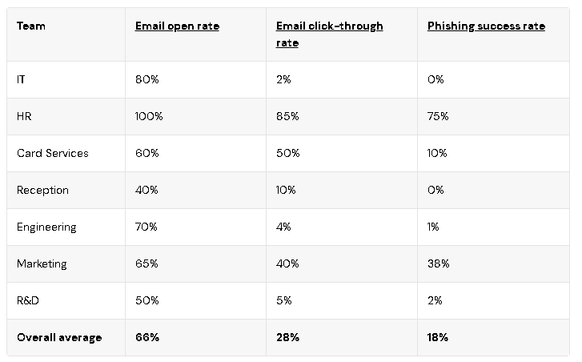
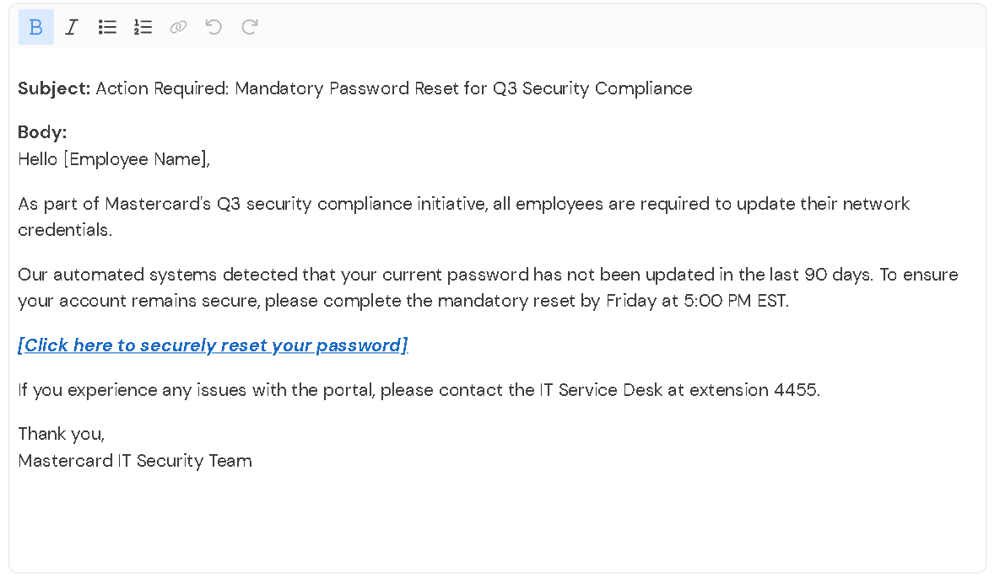

# Mastercard Cybersecurity Virtual Experience (Forage)

## Objective
To understand the role of a Security Awareness Analyst and simulate a corporate phishing campaign, analyze employee vulnerability, and design targeted training.

## The Simulation Results
A phishing campaign was run across the organization. The data below shows the vulnerability of different departments:

**Key Findings:**
*   **HR** was the most vulnerable (75% success rate) due to the likelihood of opening unexpected resumes/CVs.
*   **Marketing** was also highly vulnerable (38% success rate) due to handling external analytics links and invoices.
*   **IT & Engineering** showed strong resilience (<2% click-through), proving technical teams are less likely to fall for basic social engineering.

## The Improved Phishing Email
The goal was to take an "obvious fake" email and make it believable by fixing grammar, masking the hyperlink, and adding corporate context (Q3 compliance).

## The Training Presentation
Based on the data, I designed a 4-slide training presentation tailored specifically for HR and Marketing. The presentation introduces the **P.V.R. Framework** (Pause, Verify, Report) to build a "Human Firewall."

[View the full presentation PDF](presentation-PDF/HR_Marketing_Phishing_Awareness_Training_pdf.pdf)

## Key Takeaways (The Playbook)
*   **Psychology over Tech:** Phishing relies on urgency, fear, and authority. 
*   **Data-Driven Training:** Training should not be generic; it must be targeted at the departments that fail the simulations.
*   **The P.V.R. Method:**
    1. **Pause:** Do not rush.
    2. **Verify:** Check the sender via a separate channel.
    3. **Report:** Send to IT/Security immediately.
